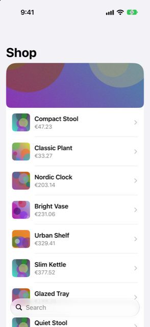

<!-- i18n-source: README.md@1467617681e9a8acbb06f02bceb1fb87e76eecdd status=reviewed -->
<!-- brand:start -->

<p align="center"><picture><source media="(prefers-color-scheme: dark)" srcset="https://raw.githubusercontent.com/muhittincamdali/sizeledger/main/.github/brand/banner-dark.svg"><source media="(prefers-color-scheme: light)" srcset="https://raw.githubusercontent.com/muhittincamdali/sizeledger/main/.github/brand/banner-light.svg"></picture></p>

<!-- lang-selector:start -->
<p align="center"><a href="README.md">English</a> · <a href="README.tr.md">Türkçe</a> · <a href="README.zh-CN.md">简体中文</a> · <a href="README.ja.md">日本語</a> · <a href="README.ko.md">한국어</a> · <a href="README.es.md">Español</a> · <a href="README.de.md">Deutsch</a> · <a href="README.fr.md">Français</a> · <a href="README.pt-BR.md">Português (Brasil)</a> · <a href="README.ru.md">Русский</a></p>
<!-- lang-selector:end -->

<p align="center">
<a href="https://github.com/muhittincamdali/sizeledger/actions/workflows/ci.yml"></a>
<a href="https://github.com/muhittincamdali/sizeledger/releases"><picture><source media="(prefers-color-scheme: dark)" srcset="https://raw.githubusercontent.com/muhittincamdali/sizeledger/main/.github/brand/badge-version-dark.svg"><source media="(prefers-color-scheme: light)" srcset="https://raw.githubusercontent.com/muhittincamdali/sizeledger/main/.github/brand/badge-version-light.svg"></picture></a>
<a href="https://github.com/muhittincamdali/sizeledger/blob/main/Package.swift"><picture><source media="(prefers-color-scheme: dark)" srcset="https://raw.githubusercontent.com/muhittincamdali/sizeledger/main/.github/brand/badge-platforms-dark.svg"><source media="(prefers-color-scheme: light)" srcset="https://raw.githubusercontent.com/muhittincamdali/sizeledger/main/.github/brand/badge-platforms-light.svg"></picture></a>
<a href="https://github.com/muhittincamdali/sizeledger/blob/main/Package.swift"><picture><source media="(prefers-color-scheme: dark)" srcset="https://raw.githubusercontent.com/muhittincamdali/sizeledger/main/.github/brand/badge-language-dark.svg"><source media="(prefers-color-scheme: light)" srcset="https://raw.githubusercontent.com/muhittincamdali/sizeledger/main/.github/brand/badge-language-light.svg"></picture></a>
<a href="https://github.com/muhittincamdali/sizeledger/blob/main/LICENSE"><picture><source media="(prefers-color-scheme: dark)" srcset="https://raw.githubusercontent.com/muhittincamdali/sizeledger/main/.github/brand/badge-license-dark.svg"><source media="(prefers-color-scheme: light)" srcset="https://raw.githubusercontent.com/muhittincamdali/sizeledger/main/.github/brand/badge-license-light.svg"></picture></a>
</p>

<p align="center">
<a href="#schnellstart"><picture><source media="(prefers-color-scheme: dark)" srcset="https://raw.githubusercontent.com/muhittincamdali/sizeledger/main/.github/brand/button-start-de-dark.svg"><source media="(prefers-color-scheme: light)" srcset="https://raw.githubusercontent.com/muhittincamdali/sizeledger/main/.github/brand/button-start-de-light.svg"></picture></a>
<a href="https://muhittincamdali.github.io/sizeledger/"><picture><source media="(prefers-color-scheme: dark)" srcset="https://raw.githubusercontent.com/muhittincamdali/sizeledger/main/.github/brand/button-docs-de-dark.svg"><source media="(prefers-color-scheme: light)" srcset="https://raw.githubusercontent.com/muhittincamdali/sizeledger/main/.github/brand/button-docs-de-light.svg"></picture></a>
<a href="https://github.com/muhittincamdali/sizeledger/tree/main/docs/guides"><picture><source media="(prefers-color-scheme: dark)" srcset="https://raw.githubusercontent.com/muhittincamdali/sizeledger/main/.github/brand/button-guides-de-dark.svg"><source media="(prefers-color-scheme: light)" srcset="https://raw.githubusercontent.com/muhittincamdali/sizeledger/main/.github/brand/button-guides-de-light.svg"></picture></a>
<a href="https://github.com/muhittincamdali/sizeledger/tree/main/Examples"><picture><source media="(prefers-color-scheme: dark)" srcset="https://raw.githubusercontent.com/muhittincamdali/sizeledger/main/.github/brand/button-examples-de-dark.svg"><source media="(prefers-color-scheme: light)" srcset="https://raw.githubusercontent.com/muhittincamdali/sizeledger/main/.github/brand/button-examples-de-light.svg"></picture></a>
</p>

> Dies ist eine Übersetzung der englischen README. Bei Abweichungen gilt die englische Fassung.

<!-- brand:end -->

Richte sizeledger auf eine `.ipa`, eine `.app` oder ein `.xcarchive`, und es zeigt dir, wo die Bytes der
App stecken: nach Kategorie, nach Framework und Ressource, nach Sprache und nach CPU-Architektur. Es liest
nur die Dateien; es baut, startet, lädt nichts hoch und ändert nichts, und es arbeitet unter macOS und
Linux gleich.

<picture><source media="(prefers-color-scheme: dark)" srcset="docs/media/demo-analyze-dark.svg"><source media="(prefers-color-scheme: light)" srcset="docs/media/demo-analyze-light.svg"></picture>

<sub>Aufgezeichnet mit dem echten Befehl (<code>node scripts/demo.mjs</code>) an
<a href="Fixtures/README.md">SampleShop 2.0</a>, einer SwiftUI-App, die dieses Repository für den
iOS Simulator baut. Die Ausgabe ist auf einem Mac (Apple silicon) und in den Linux-CI-Images dieselbe.</sub>

## Highlights

- **Eine Tabelle für die ganze App.** Hauptprogramm, Frameworks und Dylibs, App-Extensions, App Clips,
  Watch-App, Lokalisierungen, Asset-Kataloge, Codesignatur und alles andere. Die Kategorien ergeben
  immer die Gesamtsumme.
- **Jedes Framework und jede Extension in einer eigenen Zeile**, und jede `.lproj`-Sprache wird über
  die App und ihre Frameworks hinweg aufsummiert.
- **Architektur-Slices jeder Binärdatei**: welche Binärdateien universell sind und wie viel jeder Slice
  belegt; Segmentgrößen und Swift-Metadaten stehen im JSON.
- **Drei getrennte Größen**: die Summe der Dateien, eine Schätzung der Installationsgröße (ganze
  4-KiB-Blöcke, wie APFS sie speichert) und, bei einer `.ipa`, die komprimierte Größe. sizeledger gibt
  nicht vor, die Download-Größe im App Store zu kennen;
  [hier steht, warum](docs/guides/why-install-size-is-an-estimate.md).
- **Für Menschen und für CI**: eine Terminal-Tabelle, Markdown für einen Pull Request oder eine
  Job-Zusammenfassung und ein JSON-Bericht mit stabiler Schlüsselreihenfolge, den du einchecken, mit
  `jq` auswerten und vergleichen kannst.
- **Auch eine Swift-Bibliothek**: [SizeLedgerKit](https://muhittincamdali.github.io/sizeledger/) liefert
  denselben Bericht an deine eigenen Werkzeuge. Keine Abhängigkeiten: ZIP-Reader, DEFLATE-Decoder und
  Mach-O-Parser sind Teil davon.

## Schnellstart

**1. Installieren** (macOS oder Linux mit [Homebrew](https://brew.sh)):

```sh
brew install muhittincamdali/tap/sizeledger
```

Ohne Homebrew nimmst du ein [Release-Binary oder baust aus dem Quellcode](#installation).

**2. Miss deine App.** Alle diese Eingaben funktionieren: eine exportierte `.ipa`, die `.app` aus einem
Build oder ein `.xcarchive` aus **Product › Archive**.

```sh
sizeledger analyze path/to/MyApp.ipa
```

**3. Lies die Tabelle.** "By category" sagt, welche Art von Inhalt schwer ist; "Largest items" nennt die
Dateien, Frameworks und Ordner; "Binaries" zeigt, welche mehr als eine Architektur enthalten. Die Hinweise
am Ende sagen, wann eine Zahl Kontext braucht (zum Beispiel bei einem Simulator-Build). Speichere den
vollständigen Bericht mit `--out size/main.json`, um ihn aufzubewahren oder später zu vergleichen.

[Deine erste Aufschlüsselung lesen](docs/guides/read-your-first-breakdown.md) geht einen echten Bericht
Zeile für Zeile durch.

## Was heute funktioniert

| Funktion                                                                                                                       | Status        |
| ------------------------------------------------------------------------------------------------------------------------------ | ------------- |
| `analyze` für eine `.app`, `.ipa` oder ein `.xcarchive`: Kategorien, Komponenten, Sprachen, Binärdateien und Slices, Dateibaum | funktioniert  |
| Ausgabe als Terminal-Tabelle, Markdown oder JSON (`--format`, `--out`)                                                         | funktioniert  |
| macOS 13+ und Linux (x86_64 und arm64, Swift 6.2 und 6.4.1 in CI)                                                              | funktioniert  |
| Bibliothek SizeLedgerKit mit DocC-Dokumentation                                                                                | funktioniert  |
| `diff` zweier Berichte, mit einer Markdown-Zusammenfassung für Pull Requests                                                   | geplant (0.3) |
| `budget`-Regeln in YAML (pro Pfad, gesamt, App-Clip-Limit) mit Exit-Code 1 und eine GitHub Action                              | geplant (0.5) |
| HTML-Treemap in einer einzigen Datei; Asset-Katalog-Renditions über `assetutil` unter macOS                                    | geplant (0.8) |
| Eingefrorenes JSON-Schema (Version 1)                                                                                          | geplant (1.0) |
| Android `.apk` und `.aab`                                                                                                      | geplant (1.1) |

Solange es `budget` nicht gibt, ist eine Limit-Prüfung in CI eine einzige Zeile `jq`; siehe
[Größenprüfungen in CI](docs/guides/size-checks-in-ci.md).

## Installation

| Methode                 | Befehl                                                                                                                                                                                                                                         |
| ----------------------- | ---------------------------------------------------------------------------------------------------------------------------------------------------------------------------------------------------------------------------------------------- |
| Homebrew (macOS, Linux) | `brew install muhittincamdali/tap/sizeledger`                                                                                                                                                                                                  |
| Release-Binary          | Lade `sizeledger-<version>-macos-universal.tar.gz` oder `-linux-x86_64` / `-linux-aarch64` von [Releases](https://github.com/muhittincamdali/sizeledger/releases) herunter, prüfe es gegen `SHA256SUMS` und lege `sizeledger` in deinen `PATH` |
| Aus dem Quellcode       | `git clone https://github.com/muhittincamdali/sizeledger.git && cd sizeledger && swift build -c release` (das Binary liegt unter `.build/release/sizeledger`)                                                                                  |
| Swift package           | `.package(url: "https://github.com/muhittincamdali/sizeledger", from: "0.1.1")`, Product `SizeLedgerKit`                                                                                                                                       |

Zum Bauen braucht man Swift 6.2 oder neuer (auf einem Mac Xcode 26 oder neuer). Die Linux-Release-Binaries
enthalten die Swift-Runtime und benötigen glibc 2.35 oder neuer (Ubuntu 22.04, Debian 12 oder neuer).

## Verwendung

```text
sizeledger analyze <input> [--format tty|markdown|json] [--out <file>] [--top <n>] [--color auto|always|never] [--quiet]
```

| Option             | Wirkung                                                                             |
| ------------------ | ----------------------------------------------------------------------------------- |
| `<input>`          | Ein `.app`-Ordner, eine `.ipa`-Datei oder ein `.xcarchive`-Ordner                   |
| `-f, --format`     | Was ausgegeben wird: `tty` (Standard, eine Tabelle), `markdown` oder `json`         |
| `-o, --out <file>` | Schreibt den JSON-Bericht zusätzlich in eine Datei; fehlende Ordner werden angelegt |
| `--top <n>`        | Wie viele Einträge, Sprachen und Binärdateien aufgelistet werden (Standard 10)      |
| `--color`          | `auto` färbt nur in einem Terminal und nicht, wenn `NO_COLOR` gesetzt ist           |
| `-q, --quiet`      | Gibt nichts aus (zusammen mit `--out`)                                              |

Exit-Status: `0`, wenn der Bericht erstellt wurde; `2`, wenn die Eingabe nicht gelesen oder der Bericht
nicht geschrieben werden konnte (eine Zeile auf der Standardfehlerausgabe nennt den Grund); `64` bei
ungültigen Optionen. `1` ist für den geplanten Befehl `budget` reserviert.

```sh
# Keep the report for later
sizeledger analyze build/MyApp.ipa --out size/main.json

# Markdown in a GitHub Actions job summary
sizeledger analyze build/MyApp.xcarchive --format markdown >> "$GITHUB_STEP_SUMMARY"

# The ten biggest files anywhere in the bundle (bytes and file name)
jq -r '[.tree | .. | objects | select(has("children") | not)] | sort_by(-.bytes) | .[:10][] | "\(.bytes)\t\(.name)"' size/main.json
```

Der Aufbau des JSON ist im [DocC-Artikel](https://muhittincamdali.github.io/sizeledger/documentation/sizeledgerkit/jsonlayout)
beschrieben; [Fixtures/snapshots](Fixtures/snapshots) enthält vollständige Berichte.

## Die drei Größen

| Größe                                          | Bedeutung                                                             | Für SampleShop 2.0 |
| ---------------------------------------------- | --------------------------------------------------------------------- | ------------------ |
| Gesamt (`bytes`)                               | Die Summe der Dateien, so wie ein Dateimanager sie anzeigt            | 8.75 MB            |
| Installationsgröße, Schätzung (`installBytes`) | Jede Datei aufgerundet auf ganze 4-KiB-Blöcke, wie APFS sie speichert | 8.80 MB            |
| Komprimiert in der `.ipa` (`compressedBytes`)  | Was die Dateien des Bundles im Archiv belegen; nur bei `.ipa`-Eingabe | 2.72 MB            |

Keine davon ist die Download- oder Installationsgröße im App Store: Der App Store schneidet die App pro
Gerät zu (Thinning), verschlüsselt die Binärdateien und komprimiert den Download. Diese Zahlen liefern
Xcodes App Thinning Size Report und App Store Connect. sizeledger liefert die Zahlen, die sich allein aus
den Dateien gewinnen lassen, auf jedem Rechner und für jeden Build.
[Warum die Installationsgröße eine Schätzung ist](docs/guides/why-install-size-is-an-estimate.md) erklärt
die Einzelheiten, und [Größenlimits für App Clips](docs/guides/app-clip-size.md) wendet sie auf App Clips an.

## Wie getestet wird

- **Gegen `du`**, die Abnahmeprüfung für v0.1, an den beiden SampleShop-Versionen, die aus der `.ipa`
  entpackt wurden. Auf einem Mac (Apple silicon, macOS 27.0.1, APFS) ist die Installationsschätzung
  exakt gleich `du -sk`, und die Gesamtgröße weicht um höchstens 0.16% von `du -A` ab; im Linux-Container
  (swift:6.4.1-noble, aarch64) ist die Gesamtgröße gleich `du -b --apparent-size`, und die
  Installationsschätzung weicht um höchstens 0.65% von `du -sk` ab, das dort auch 4 KiB pro Ordner zählt.
  Die Tests schlagen bei beiden ab 1% Abweichung fehl.
- **Snapshots**: Die JSON-, Text- und Markdown-Berichte beider Versionen sind eingecheckt; dieselben
  Snapshots bestehen unter macOS und unter Linux.
- **Eine echte App**: SampleShop wird von [einem Skript](Fixtures/scripts/build-sample-app.sh) mit
  `swiftc`, `actool` und `codesign` gebaut und läuft im iOS-27.0-Simulator:

    <picture><source media="(prefers-color-scheme: dark)" srcset="docs/media/sampleshop-ios27-simulator-dark.png"><source media="(prefers-color-scheme: light)" srcset="docs/media/sampleshop-ios27-simulator-light.png"></picture>

- **Reader gegen Referenzen geprüft**: der DEFLATE-Decoder gegen die Ausgabe von zlib für Stored-,
  Fixed- und Dynamic-Blöcke; der Mach-O-Parser an Thin-, 32-Bit-, Fat- und Fat64-Dateien; außerdem
  ZIP64, beschädigte Archive und Dateinamen, die Escape-Sequenzen für das Terminal enthalten.

Insgesamt sind es 95 Tests, die CI unter macOS und unter Linux (x86_64 und arm64) ausführt. Das Messen
von SampleShop 2.0 dauert im Median 11.4 ms über 21 Läufe auf einem Mac (Apple silicon) mit dem
Release-Build.

## Grenzen

- Größen sind lokale Messwerte. Download- und Installationsgrößen im App Store hängen von Thinning,
  Verschlüsselung und Komprimierung ab, die bei Apple geschehen; deshalb meldet sizeledger eine
  Schätzung und sagt das auch.
- Asset-Kataloge (`Assets.car`) werden als Dateien gezählt; die darin enthaltenen Renditions werden noch
  nicht aufgelistet (geplant für 0.8, über `assetutil` unter macOS).
- Swift-Metadaten sind die Größe der `__swift5_*`-Sektionen und damit eine Untergrenze: Ein Teil der
  Metadaten liegt in `__const`.
- Bundles im iOS-Stil (iOS, iPadOS, tvOS, watchOS, visionOS) werden klassifiziert. Eine macOS-`.app` mit
  einem Ordner `Contents/` wird gemessen, ihre Dateien landen aber unter "Other resources".
- Eine `.ipa` mit mehr als einer App, verschlüsselten Einträgen, einer anderen Komprimierung als
  Stored und DEFLATE oder einem Eintragspfad mit einer `..`-Komponente wird mit einer Meldung
  abgelehnt, nicht erraten.
- Um einen Mach-O-Header weit hinten in einem komprimierten `.ipa`-Eintrag zu erreichen, entpackt
  sizeledger alles davor und behält nur ein Fenster von 32 KiB; ein präparierter Eintrag kostet also
  Zeit, keinen Speicher: etwa 1 s pro entpacktem GB auf einem Mac (Apple silicon).

## Dokumentation

- [Anleitungen](docs/guides/): deine erste Aufschlüsselung lesen, die Schätzung der Installationsgröße,
  Größenlimits für App Clips, Größenprüfungen in CI.
- [API-Dokumentation](https://muhittincamdali.github.io/sizeledger/) (DocC) für SizeLedgerKit, mit
  Einstieg und JSON-Aufbau.
- [Beispiele](Examples/): ein Swift-Programm auf Basis von SizeLedgerKit und ein GitHub-Actions-Workflow.
- [Changelog](CHANGELOG.md).

## Mitwirken

Am meisten helfen Fehlerberichte mit einer kleinen App, die das Problem zeigt. Zum Bauen, zu den Tests
und zu den Snapshots siehe [CONTRIBUTING.md](CONTRIBUTING.md), zum vertraulichen Melden einer
Sicherheitslücke [SECURITY.md](SECURITY.md).

## Lizenz

[MIT](LICENSE)
